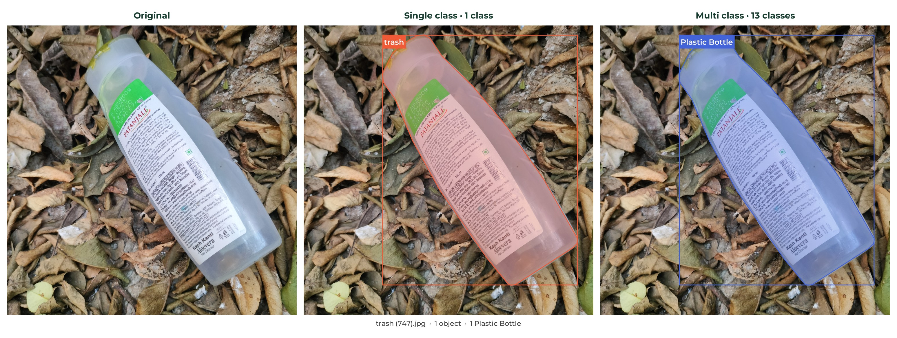
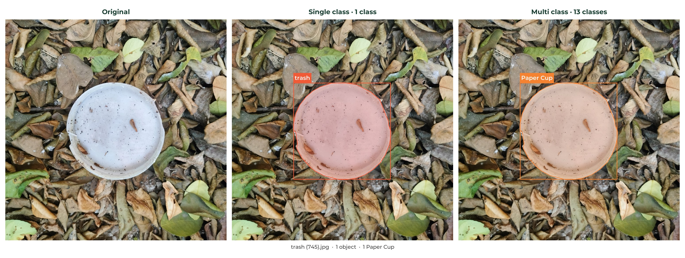
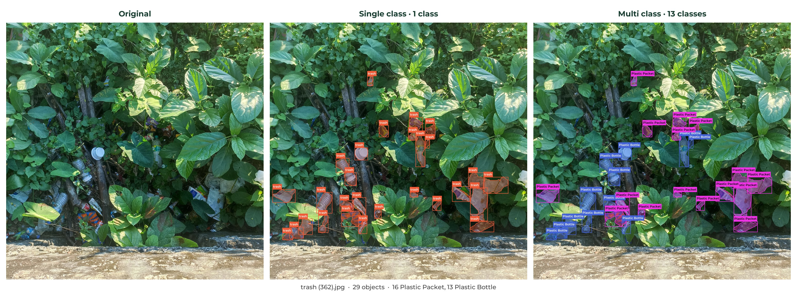
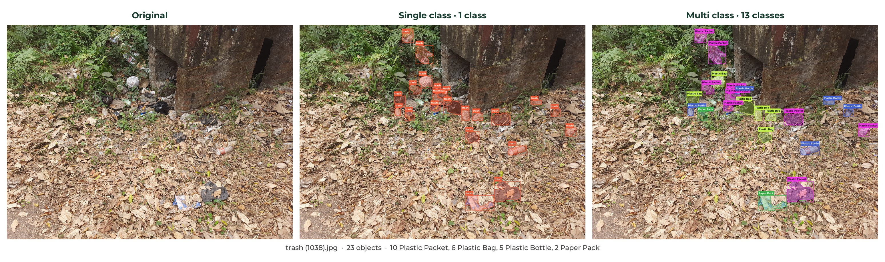
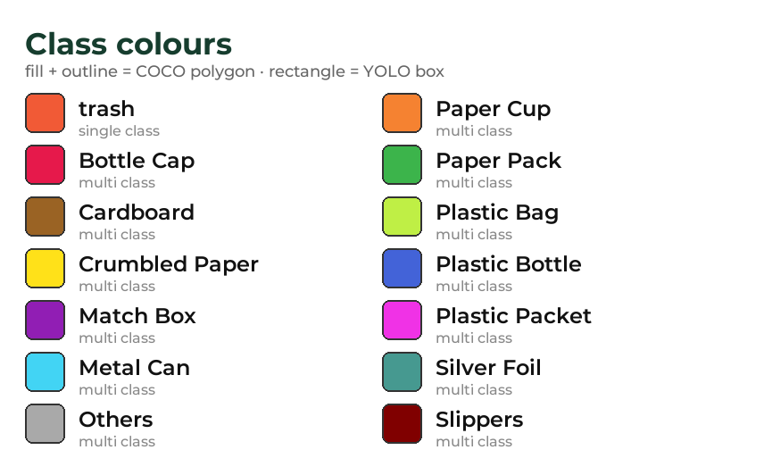

<div align="center">

# 🗑️ CLICK Trash Detection Dataset

### Real litter, real ground, real clutter · 1,126 images · 2,213 polygon-labelled objects

**One set of photos, one set of polygons, two label spaces:**
🟠 **single class** (`trash`) for litter detection · 🟣 **multi class** (13 materials) for trash type detection

[](#)
[](#)
[](#)
[](#)
[](#)
[](https://doi.org/10.17632/473x7yf3vy.1)
[](https://github.com/<org>/<repo>)

</div>

---

## 📖 Contents

1. [What is CLICK?](#-what-is-click)
2. [Annotation pipeline: SAM 3 + Label Studio](#-annotation-pipeline-sam-3--label-studio)
3. [Sample annotations, single vs multi class](#-sample-annotations-single-vs-multi-class)
4. [Dataset statistics](#-dataset-statistics)
5. [Classes](#-classes)
6. [Folder structure](#-folder-structure)
7. [Label formats](#-label-formats)
8. [Training](#-training)
9. [Quality checks](#-quality-checks)
10. [Official DOI and citation](#-official-doi-and-citation)
11. [Where the dataset is shared](#-where-the-dataset-is-shared)
12. [Official GitHub repository](#-official-github-repository)
13. [License](#-license)
14. [Acknowledgements](#-acknowledgements)

---

## 🌍 What is CLICK?

CLICK is an image dataset for detecting litter where it actually lies: on soil, in leaf litter, in grass, on gravel and along paths, photographed outdoors with a phone in natural light. Every piece of trash in every photo is outlined with a polygon, so the dataset supports both **object detection** (boxes) and **instance segmentation** (masks).

The same photos and polygons are shipped with two label spaces, packed together so that no photo is stored twice:

| | 🟠 Single class | 🟣 Multi class |
|:--|:--|:--|
| **Question answered** | Is this object trash? | Is this object trash, and what is it made of? |
| **Classes** | 1 · `trash` | 13 · Plastic Packet, Plastic Bottle, Paper Pack, … |
| **Use it for** | General litter detectors, clean-up robots, coverage mapping | Material-aware sorting, recycling analytics, fine-grained benchmarks |
| **Labels live in** | `single class/` | `multi class/` |
| **Images and split** | shared `images/` · train / val / test | shared `images/` · identical train / val / test |

Because the split and the polygons are identical, a model trained on the single-class labels can be fine-tuned on the multi-class labels, and results on the two can be compared image for image.

---

## 🧭 Annotation pipeline: SAM 3 + Label Studio

Every annotation went through a machine-assisted first pass and a human review. No object in this release is unreviewed model output.

```
 📷 1,126 photos
      │
      ▼
 🤖 Segment Anything Model 3 (SAM 3) · Meta AI
      │   pixel-accurate mask proposals for the litter in each photo,
      │   converted to polygon annotations
      ▼
 🧑‍💻 Manual verification in Label Studio
      │   every image opened and checked by hand:
      │   · polygon edges corrected
      │   · missed objects added, false proposals removed
      │   · each object assigned one of 13 material classes
      ▼
 📦 Export
          fixed random split (seed 42) → YOLO boxes + COCO polygons
          written twice: 1 class (`trash`) and 13 classes
```

**Why SAM 3 first?** Hand-drawing a tight polygon around a crumpled packet takes minutes. SAM 3 gives a pixel-accurate outline in one click, so the human effort goes into *checking* rather than *tracing*, and the outlines are more consistent than manual ones.

**Why a full manual pass?** Segmentation models do not know what trash is. They outline leaves, stones and shadows just as happily. The Label Studio review removes those, catches small objects the model missed, and adds the material label that no segmentation model can supply.

---

## 🖼️ Sample annotations, single vs multi class

The images below are taken from the dataset and rendered from the shipped label files. Each sheet shows the **original photo**, the **single-class labels** and the **multi-class labels** for the same image. In every annotated panel:

- the **light coloured fill** with a solid outline is the **COCO polygon** (instance segmentation)
- the **rectangle** is the **YOLO box** read from the `.txt` label file, with the **class name** on top of it
- colours follow the legend at the end of this section

All sample files, including the untouched originals, are in [`previews/`](previews/).

### One object per image

Single-object images make up about 57 % of the dataset. The polygon hugs the object and the YOLO box is the tight box around that polygon.

**trash (747).jpg · a Plastic Bottle on leaf litter**



**trash (745).jpg · a Paper Cup**



### Many objects per image

Crowded scenes are where the two label spaces differ most. The single-class view says *where* the litter is; the multi-class view says *what* it is, and shows how mixed a real dump site can be.

**trash (362).jpg · 29 objects, the busiest image in the dataset · 16 Plastic Packet, 13 Plastic Bottle**



**trash (1038).jpg · 23 objects across 4 classes · 10 Plastic Packet, 6 Plastic Bag, 5 Plastic Bottle, 2 Paper Pack**



### Legend



Individual panels are also saved separately as `previews/trash_<N>_single_class.jpg` and `previews/trash_<N>_multi_class.jpg`, with the full-resolution originals as `previews/trash_<N>_original.jpg`.

---

## 📊 Dataset statistics

### Splits (shared by both label spaces)

| Split | Images | Objects | Share |
|:------|-------:|--------:|------:|
| 🟢 train | 901 | 1,802 | 80 % |
| 🟡 val | 113 | 221 | 10 % |
| 🔴 test | 112 | 190 | 10 % |
| **Total** | **1,126** | **2,213** | 100 % |

### Images and objects

| | |
|:--|:--|
| Objects per image | about 2 on average, 1 in 643 images, up to 29 |
| Background images | 4 photos with no litter, kept as negatives (empty YOLO file, no COCO annotations) |
| Resolution | high-resolution phone photos, predominantly 3072 × 3072 px |
| Orientation | EXIF rotation baked into the pixels, so labels always match what you see |
| Scenes | soil, leaf litter, grass, gravel and paths, outdoors, natural light |
| Numbering | `trash (1).jpg` to `trash (1126).jpg`, serial, no gaps |

---

## 🏷️ Classes

YOLO ids start at 0 and equal the line index in each `classes.txt`. COCO category ids start at 1.

### 🟠 Single class

| YOLO id | COCO id | Class | Train | Val | Test | Total |
|--------:|--------:|:------|------:|----:|-----:|------:|
| 0 | 1 | trash | 1,802 | 221 | 190 | 2,213 |

### 🟣 Multi class

| YOLO id | COCO id | Class | Train | Val | Test | Total | Images |
|--------:|--------:|:------|------:|----:|-----:|------:|-------:|
| 0 | 1 | Bottle Cap | 12 | 2 | 0 | 14 | 13 |
| 1 | 2 | Cardboard | 5 | 1 | 5 | 11 | 6 |
| 2 | 3 | Crumbled Paper | 200 | 18 | 12 | 230 | 142 |
| 3 | 4 | Match Box | 1 | 0 | 0 | 1 | 1 |
| 4 | 5 | Metal Can | 16 | 1 | 1 | 18 | 17 |
| 5 | 6 | Others | 16 | 1 | 3 | 20 | 18 |
| 6 | 7 | Paper Cup | 68 | 14 | 5 | 87 | 66 |
| 7 | 8 | Paper Pack | 261 | 28 | 25 | 314 | 213 |
| 8 | 9 | Plastic Bag | 109 | 17 | 4 | 130 | 97 |
| 9 | 10 | Plastic Bottle | 198 | 22 | 27 | 247 | 198 |
| 10 | 11 | Plastic Packet | 893 | 114 | 105 | 1,112 | 629 |
| 11 | 12 | Silver Foil | 21 | 2 | 3 | 26 | 22 |
| 12 | 13 | Slippers | 2 | 1 | 0 | 3 | 3 |
| | | **All** | **1,802** | **221** | **190** | **2,213** | **1,122** |

> ⚠️ **Long-tail distribution.** The balance mirrors what is actually found on the ground: Plastic Packet alone is half of all objects, while Match Box, Slippers, Cardboard and Bottle Cap have fewer than 15 instances each. Four classes have zero instances in at least one split (Bottle Cap and Slippers in test, Match Box in val and test). When training on the multi-class labels, consider class-weighted or focal losses, oversampling of rare classes, merging the rarest classes into `Others`, and reporting per-class metrics so rare classes are not hidden behind Plastic Packet.

---

## 🗂️ Folder structure

The photos are stored once, in a shared `images/` folder split into train, val and test. Each label space is a folder next to it with its own YOLO `labels/`, COCO `annotations/`, `classes.txt` and `data.yaml`, so switching between litter detection and trash type detection is a matter of pointing at a different folder, and the 5 GB of photos are never duplicated.

```
<dataset_root>/
├── images/                          # shared by both label spaces
│   ├── train/   trash (N).jpg       #   901 images
│   ├── val/                         #   113 images
│   └── test/                        #   112 images
│
├── single class/                    # 🟠 1 class: trash
│   ├── labels/{train,val,test}/     #   YOLO boxes, trash (N).txt
│   ├── annotations/                 #   COCO instance segmentation
│   │   ├── instances_train.json
│   │   ├── instances_val.json
│   │   └── instances_test.json
│   ├── classes.txt
│   └── data.yaml
│
├── multi class/                     # 🟣 13 classes
│   ├── labels/{train,val,test}/
│   ├── annotations/
│   ├── classes.txt
│   └── data.yaml
│
└── KAGGLE_README.md                 # the dataset description used on Kaggle
```

Every path inside a `data.yaml` is relative to the folder that contains it (`train: ../images/train` and so on) and there is no `path:` key, so the yaml files work unchanged wherever the dataset is unpacked.

### Repository layout

The release above is the `Dataset/01 Full Dataset/` folder of this repository. Around it the repository holds the Label Studio sources the labels were made from, the training code, the preview images used on this page, the project website and the design assets:

```
<repository_root>/
├── Dataset/
│   ├── 01 Full Dataset/                     # <dataset_root>, the release shown above (not in git, see below)
│   └── 02 Label Studio Project Files/
│       ├── annotation_configuration.xml     # Label Studio labelling interface
│       ├── annotation_project_export.json   # reviewed polygons, Label Studio export
│       └── yolo_coco_dataset_creation.ipynb # export → split → YOLO boxes + COCO polygons
│
├── Notebooks/
│   ├── train_yolo.py                        # train YOLO n/s/m/l/x at 640, both label spaces
│   ├── train_yolo.ipynb                     # the same as a notebook, with result plots
│   └── render_previews.py                   # draws the preview sheets above from the label files
│
├── previews/                                # the illustration images used in this README
├── Website/                                 # project website: index.html, style.css, script.js, assets/
├── Design Assets/                           # logo (AI + SVG), launch image, fonts
├── .gitignore                               # keeps Dataset/01 Full Dataset (5 GB of photos) out of git
└── README.md                                # this file
```

The photos and labels are **not committed to git**. Download the release from one of the mirrors listed under [Where the dataset is shared](#-where-the-dataset-is-shared) and unpack it as `Dataset/01 Full Dataset/`. The training files resolve the dataset relative to their own location, so once it is in place the repository trains without editing a single path.

A label file and a COCO entry exist for every image in every split, in both label spaces. `trash (N).txt` in `single class/labels/train/` and in `multi class/labels/train/` describe the same boxes on the same photo; only the class ids differ.

---

## 🧾 Label formats

**YOLO** (`<label space>/labels/<split>/trash (N).txt`), one object per line, `class cx cy w h`, normalised to 0–1:

```
# single class/labels/train/trash (10).txt
0 0.446125 0.595865 0.072590 0.056970
0 0.473368 0.636447 0.037123 0.030689

# multi class/labels/train/trash (10).txt   (same boxes, 10 = Plastic Packet)
10 0.446125 0.595865 0.072590 0.056970
10 0.473368 0.636447 0.037123 0.030689
```

**COCO** (`<label space>/annotations/instances_<split>.json`), standard instance-segmentation layout with polygon `segmentation`, `bbox` in `[x, y, w, h]` pixels, polygon `area` and `iscrowd`:

```json
{
  "images":      [{"id": 2, "file_name": "trash (10).jpg", "width": 3072, "height": 3072}],
  "annotations": [{"id": 1, "image_id": 2, "category_id": 11,
                   "segmentation": [[1262.0, 1744.0, 1259.0, 1751.0, ...]],
                   "bbox": [1259.0, 1742.99, 223.0, 175.01],
                   "area": 21142.27, "iscrowd": 0}],
  "categories":  [{"id": 1, "name": "Bottle Cap"}, ..., {"id": 13, "name": "Slippers"}]
}
```

The YOLO box is the tight bounding box of the COCO polygon, so the two formats always agree. COCO `file_name` values are bare file names; prepend `images/<split>/` to locate the file.

---

## 🚀 Training

### COCO loaders (Detectron2, MMDetection, pycocotools)

Point the loader at the annotation file of the label space you want and at the shared image folder for that split:

```python
from pycocotools.coco import COCO
coco = COCO("path/to/dataset/multi class/annotations/instances_train.json")
img_dir = "path/to/dataset/images/train"
print(len(coco.getImgIds()), "images,", len(coco.getAnnIds()), "objects")
```

### Ultralytics YOLO

Ultralytics finds the label of every image by replacing `images` with `labels` in its path, so it needs a folder where `images/` and `labels/` sit side by side. With the shared `images/` folder that pair does not exist on disk, and there are two ways to provide it, neither of which copies a photo:

- **Use the baseline script or notebook** (next section). Before every run it links `images/` and the chosen label space's `labels/` into `runs/workspace/<space>/`, writes a `data.yaml` there and trains from it. Nothing to set up.
- **Do it once by hand** for the `yolo` command line. Create a folder with two links and a yaml, then train as usual:

  ```bash
  # Windows (cmd, no admin rights needed)
  mkdir ws\multi
  mklink /J ws\multi\images "path\to\dataset\images"
  mklink /J ws\multi\labels "path\to\dataset\multi class\labels"
  copy "path\to\dataset\multi class\data.yaml" ws\multi\data.yaml

  # Linux / macOS
  mkdir -p ws/multi
  ln -s "path/to/dataset/images"              ws/multi/images
  ln -s "path/to/dataset/multi class/labels"  ws/multi/labels
  cp    "path/to/dataset/multi class/data.yaml" ws/multi/data.yaml
  ```

  In the copied `data.yaml` change `../images/train` to `images/train` (and the same for val and test), then:

  ```bash
  yolo detect train data=ws/multi/data.yaml model=yolo11n.pt imgsz=640 epochs=100
  ```

  Repeat with `single class` for the single-class baseline.

### Baseline script and notebook

The repository ships `train_yolo.py` and `train_yolo.ipynb` in its `Notebooks/` folder. Both train one detector per (label space, model size) pair at `imgsz=640`, evaluate every best checkpoint on the **test** split and collect the results in one table, so the single-class and multi-class baselines are produced under identical settings.

| | |
|:--|:--|
| **Label spaces** | `single class`, `multi class` (default: both) |
| **Model sizes** | `n`, `s`, `m`, `l`, `x` (default: all five; `xl` is accepted as an alias of `x`) |
| **Family** | YOLO11 by default, `--family yolov8` or `yolo12` to switch |
| **Settings** | 640 px, 100 epochs, early stopping after 30 epochs without improvement, seed 42, auto batch size |
| **Outputs** | `runs/detect/<space>_<model>/` with weights, curves and confusion matrices, `runs/detect/<space>_<model>_test/` with the test evaluation, and `runs/detect/summary.csv` + `summary.md` with parameters, test mAP50-95, mAP50, precision, recall and inference time per run |

```bash
# all ten baselines: 2 label spaces x 5 sizes
python Notebooks/train_yolo.py

# a subset, with a fixed batch size for a small GPU
python Notebooks/train_yolo.py --space multi --sizes n s m --epochs 100 --batch 8

# dataset unpacked somewhere else (Kaggle, a shared drive, ...)
python Notebooks/train_yolo.py --dataset-root "/kaggle/input/<dataset-slug>" --project /kaggle/working/runs
```

`--skip-existing` skips runs whose `best.pt` already exists and `--resume` continues interrupted runs from their `last.pt`, so the full sweep can be run in several sessions. The summary table is rewritten after every run, so an interrupted sweep still leaves a complete table for the runs that finished. The notebook exposes the same options in its first code cell and adds a results table, a test-mAP-against-parameters plot, the training curves of any run and a few test predictions.

For segmentation training convert the COCO polygons to YOLO segment labels, for example with `ultralytics.data.converter.convert_coco`.

---

## ✅ Quality checks

Before release the dataset passed the following automated checks, in both label spaces and every split:

- every image has a matching YOLO label file and a COCO image entry
- every bounding box lies inside its image, with no degenerate or duplicate boxes
- every YOLO box and class id matches its COCO polygon and category to within 0.1 % of the image size
- image pixel dimensions match the width and height stored in COCO
- the single-class and multi-class files describe the same images, same split and same object geometry

---

## 🔖 Official DOI and citation

The dataset has a persistent identifier. Please cite it when you use CLICK in a paper, a product or a derived dataset.

| | |
|:--|:--|
| **DOI** | [`10.17632/473x7yf3vy.1`](https://doi.org/10.17632/473x7yf3vy.1) |
| **Version** | v1.0 · released 2026 |
| **Record** | Mendeley Data · [https://data.mendeley.com/datasets/473x7yf3vy/1](https://data.mendeley.com/datasets/473x7yf3vy/1) |

```bibtex
@dataset{click_trash_2026,
  title     = {CLICK Trash Dataset},
  author    = {Baishya, Manjit},
  year      = {2026},
  version   = {1.0},
  publisher = {Mendeley Data},
  doi       = {10.17632/473x7yf3vy.1},
  url       = {https://doi.org/10.17632/473x7yf3vy.1}
}
```

---

## 🔗 Where the dataset is shared

The same release is mirrored on the platforms below. All mirrors carry identical images, labels and splits; the DOI record is the version of record.

| Platform | Link | Notes |
|:--|:--|:--|
| 🏛️ Mendeley Data (version of record) | https://doi.org/10.17632/473x7yf3vy.1 | archived, citable, full download |
| 🤗 Hugging Face Datasets | https://huggingface.co/datasets/<org>/click-trash-detection | `datasets.load_dataset(...)` |
| 📦 Kaggle | https://www.kaggle.com/datasets/<user>/click-trash-detection | notebooks and discussion |
| 🌐 Project website | https://<your-domain> | overview, samples, news |

<!-- Replace the placeholder links above with the real ones, and delete any row that does not apply. -->

---

## 🐙 Official GitHub repository

Code, issues and updates live on GitHub:

**https://github.com/<org>/<repo>**

The repository contains:

- `Dataset/02 Label Studio Project Files/`: the labelling configuration (`annotation_configuration.xml`), the reviewed Label Studio export (`annotation_project_export.json`) and the conversion notebook (`yolo_coco_dataset_creation.ipynb`) that turns the reviewed polygons into the YOLO and COCO release
- `Notebooks/train_yolo.py` and `Notebooks/train_yolo.ipynb`: the baseline training script and notebook described under [Training](#-training), which train YOLO `n`, `s`, `m`, `l` and `x` at 640 on both label spaces and evaluate them on the test split
- `Notebooks/render_previews.py`: the script that draws the sample overlays in [`previews/`](previews/) from the shipped label files
- `previews/`: the comparison sheets, single panels and full-resolution originals shown on this page
- `Website/` and `Design Assets/`: the project website and the logo, launch image and fonts
- the dataset release itself is not in git; it is downloaded from the mirrors above into `Dataset/01 Full Dataset/`
- baseline results as they are added

Found a wrong label or a missed object? Please open an issue there with the image name, for example `trash (362).jpg`, and a short description.

---

## 📄 License

<!-- State the license here, e.g. CC BY 4.0, and link to the LICENSE file in the repository. -->
This dataset is released under **<LICENSE>**. See the [LICENSE](https://github.com/<org>/<repo>/blob/main/LICENSE) file for the full text.

---

## 🙏 Acknowledgements

- **Segment Anything Model 3 (SAM 3)** by **Meta AI** for first-pass segmentation proposals
- **Label Studio** by HumanSignal for the manual review and annotation tooling
- Everyone who photographed litter so that machines can learn to see it

---

<div align="center">

**CLICK** · *You can't clean up what you can't see.*

</div>
